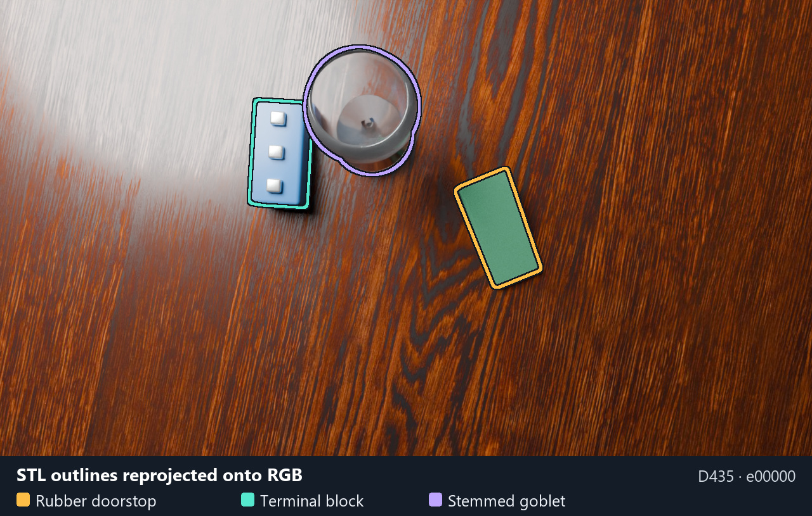
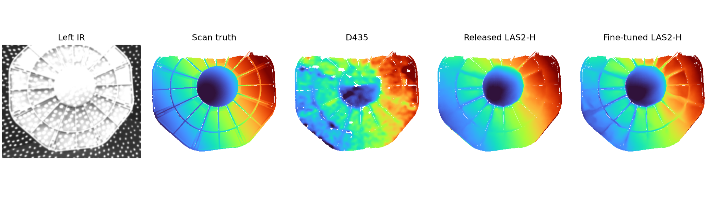

# Random Dot Stereo Club

*For the love of random dots and stereo vision.*

> **Dataset v1 is available.** [Download Train, Eval, Challenge, and shared STL meshes on Zenodo](https://doi.org/10.5281/zenodo.24564844), or try a [sample](#play-with-the-samples).

Point a random-dot projector at a plain tabletop and suddenly your stereo pair has a pattern to match. That’s what I love about a RealSense setup like the D435 or D555. **Two IR cameras, a color camera, and a random-dot projector!** The projector gives the IR pair texture to work with, and the color camera adds another view. If we already have all three views, why not see what learning-based methods can measure with them?

I wanted a realistic synthetic dataset that would give more people a chance to try those ideas. So I made one. Welcome to the club.

## Dataset at a glance

[](samples/dataset-overview.jpg)

These are renders from the dataset. RGB is shown at a larger size to make the materials, reflections, and transparent objects easier to inspect. Click the image to zoom in.


## Play with the samples

[Download the sample ZIP](samples/sample-e00000.zip) for the same tabletop scene captured with all three camera configurations. It includes the images, ground-truth disparity, masks, calibration, and pose and OBB JSONs.

To use the shared meshes, download or clone this repository, then extract the sample ZIP beside `meshes/`. It creates a `sample/` folder. The Train and Eval archives will create sibling folders.

| Camera | Visual preview |
| --- | --- |
| D435 | [View preview](samples/D435.png) |
| D555 | [View preview](samples/D555.png) |
| OAK-D with a simulated projector | [View preview](samples/OAK-D-active.png) |


The previews show the stereo pair, ground-truth disparity, a LAS2-H prediction, absolute error, and the stereo visibility mask.


## Camera calibration

[D435](calibration/D435.json) · [D555](calibration/D555.json) · [OAK-D with simulated projector](calibration/OAK-D-active.json)

The JSON files contain intrinsics for 1280 × 720 images, the stereo baseline, transforms from the left IR camera to the other views, and the projector position and field of view. The optical axes point right (+X), down (+Y), and forward (+Z). Intrinsics are in pixels and translations are in meters. The simulation uses ideal pinhole cameras with zero lens distortion and nominal camera geometry. The OAK-D variant adds a simulated dot projector.

For positive left IR disparity `d`, depth is `Z = fx_left × baseline / d`. Back-project the pixel with `X_left = Z × inv(K_left) × [u, v, 1]ᵀ`. To project it into RGB, apply `X_rgb = R × X_left + t_m`, then project with `K_rgb`.

## Convert disparity to depth with PyTorch

The [example script](examples/disparity_to_depth.py) loads the calibration JSON and runs a placeholder `predict_disparity(left, right)` function. The placeholder returns 32 pixels everywhere, so the output is a fronto-parallel plane.

```bash
python examples/disparity_to_depth.py --calibration calibration/D435.json --output depth_m.npy
```

To use your own network, replace the example input tensors with a preprocessed, rectified stereo pair and implement `predict_disparity` with your model. Return left-reference disparity in pixels as a `[B, H, W]` tensor on the input device. Remove model padding and, if you resized the images, restore both the calibrated image dimensions and the disparity scale.

The example uses CUDA automatically when available. Use `--device cuda` or `--device cpu` to choose explicitly. The conversion runs on the input device and produces a float32 depth image in meters. Zero, negative, and non-finite disparities become NaN. Positive disparities below 1 px are converted as well.

## Dataset

Scenes are rendered in Blender at 1280 × 720. Each camera configuration includes paired IR views, RGB, ground-truth disparity on the left IR and RGB pixel grids, RGB-aligned instance masks, and masks for geometric validity, stereo visibility, and transparent materials.

Both disparity maps store left-minus-right IR disparity in pixels. In `disparity_rgb.pfm`, those values are sampled on the RGB pixel grid. Ground truth comes from the first surface hit, including transparent surfaces and surfaces occluded in the other IR view. Pixels with no surface hit contain NaN. Camera views share the scene geometry, and the two IR views share a random-dot pattern generated from the scene’s recorded seed.

The **Eval** set uses held-out object shapes, indoor HDRIs, and textures. Paired scene IDs let you compare the same layout across all three camera configurations.

Download the archives from the [Zenodo v1 record](https://doi.org/10.5281/zenodo.24564844).

| Archive | Contents |
| --- | --- |
| `d435-train-v1.zip` | 1,000 D435 scenes |
| `d555-train-v1.zip` | 1,000 D555 scenes |
| `oak-d-active-train-v1.zip` | 1,000 OAK-D scenes |
| `eval-v1.zip` | 200 scenes per camera configuration |
| `challenge-v1.zip` | 3 scenes per camera configuration |
| `shared-meshes-v1.zip` | Shared STL meshes and mesh catalog |

## For 3D object recognition

The 3D annotations pair each object instance with a local STL mesh and its 6DoF pose at capture time. Instance IDs match the RGB segmentation masks. Mesh coordinates and pose translations are in meters. The JSON gives both `T_left_ir_from_mesh` and `T_rgb_from_mesh` as row-major 4 × 4 matrices acting on homogeneous column vectors. Use the corresponding camera intrinsics to project the mesh into an image. `obb_left_ir` and `obb_rgb` give the oriented box center, full XYZ side lengths, and box-to-camera rotation in each view. The box axes follow the mesh frame. Meshes are shared across camera views of the same scene.



[View the same scene with the oriented 3D bounding boxes projected onto RGB.](samples/obb-pose-overlay.jpg)

This example uses the outlines reconstructed from STL geometry and pose JSON. After projection into the RGB view with the scene's occluders, the instance labels agreed with the dataset mask at all 921,600 pixels.

The [sample ZIP](samples/sample-e00000.zip) includes poses and oriented boxes in both the left IR and RGB frames. The v1 Train, Eval, and Challenge archives include a per-scene `objects_3d.json` in each camera sample. Use the mesh catalog from `shared-meshes-v1.zip` with these archives. The bottle meshes include the rigid container, cap, and label. The simulated liquid remains part of the images.


### Pair images with the shared meshes

Extract the v1 data archives and `shared-meshes-v1.zip` into the same data directory. Train downloads are organized by camera. Eval and Challenge each contain all three cameras, with matching scene IDs across camera views.

```text
random-dot-stereo-data/
├── meshes/
│   ├── catalog.json
│   └── *.stl
├── sample/
│   ├── D435/
│   │   ├── calibration.json
│   │   └── e00000/
│   ├── D555/
│   └── OAK-D-active/
├── train/
│   ├── D435/
│   │   ├── calibration.json
│   │   └── 00100/
│   │       ├── rgb.png
│   │       ├── ir_left.png
│   │       ├── ir_right.png
│   │       ├── disparity_left.pfm
│   │       ├── disparity_rgb.pfm
│   │       ├── segmentation_rgb.png
│   │       ├── objects_3d.json
│   │       └── cables_3d.json
│   ├── D555/
│   └── OAK-D-active/
└── eval/
    ├── D435/
    ├── D555/
    └── OAK-D-active/
```

Each camera folder keeps its shared `calibration.json` at the top level. The scene folders sit directly alongside `calibration.json` and are named by scene ID. This applies to `sample/`, `train/`, and `eval/`. The disparity validity, stereo visibility, and transparent material masks are also in each scene folder. Scenes with cables have a `cables_3d.json` containing cable instance IDs and OBBs in the left IR and RGB frames. Cable labels remain in the RGB mask.

Paths in `objects_3d.json` are relative to that scene directory. Use `mesh_id` to identify the shared geometry. Given a vertex `p_stl` in meters, compute `p_rgb = R @ (scale_xyz * p_stl) + t`, with `R` and `t` taken from `T_rgb_from_mesh`. The OBBs are already expressed in their respective camera frames.

```python
import json
from pathlib import Path

import numpy as np

scene = Path("sample/D435/e00000")
annotation = json.loads((scene / "objects_3d.json").read_text(encoding="utf-8"))
instance = annotation["instances"][0]

rgb_path = scene / annotation["rgb_image"]
mask_path = scene / annotation["rgb_instance_mask"]
stl_path = (scene / instance["mesh_stl"]).resolve()
instance_id = instance["instance_id"]
scale = np.asarray(instance["scale_xyz"])
pose = np.asarray(instance["T_rgb_from_mesh"])

# vertices_stl is an [N, 3] array read from stl_path, in meters.
def to_rgb_camera(vertices_stl):
    return (vertices_stl * scale) @ pose[:3, :3].T + pose[:3, 3]
```


## LAS2-H fine-tuning experiment

I fine-tuned the released LAS2-H weights for 3,000 steps, using one 256 × 512 crop per scene per epoch over all 1,000 D435 v2 Train scenes for three epochs. On 48 held-out synthetic D435 Eval scenes from v1, I measured stereo-visible object surfaces 2–20 mm above the tabletop. Mean height error fell from **6.82 to 4.03 mm**. The share of those pixels predicted below half their ground-truth height fell from **52.7% to 14.1%**. The reported values are averages across scenes.

I also ran the three methods on eight Skoltech3D D435 views of two objects, using the same rectified real IR pairs for both LAS2-H models and independent structured-light scans as ground truth.

I used Skoltech3D solely for this non-commercial evaluation. Fine-tuning used only the synthetic D435 v2 Train split. [Skoltech3D license](https://skoltech3d.appliedai.tech/#license)

Dataset reference — Voynov et al. (2023), *Multi-Sensor Large-Scale Dataset for Multi-View 3D Reconstruction*, CVPR. [Paper](https://openaccess.thecvf.com/content/CVPR2023/html/Voynov_Multi-Sensor_Large-Scale_Dataset_for_Multi-View_3D_Reconstruction_CVPR_2023_paper.html) · [Dataset](https://skoltech3d.appliedai.tech/)

| Method | Depth MAE on common valid object pixels ↓ | Object pixels within 5 mm ↑ | Silhouette-band MAE ↓ |
| --- | ---: | ---: | ---: |
| D435 device depth | 6.53 mm | 43.6% | 6.78 mm |
| Released LAS2-H | 4.56 mm | 73.0% | 11.01 mm |
| LAS2-H fine-tuned on synthetic IR | 3.34 mm | 81.7% | 6.09 mm |

The 5 mm metric counts missing predictions as failures. Silhouette-band MAE uses each method's valid pixels within three pixels of the scan silhouette. On this two-object subset, the released LAS2-H improved overall depth MAE over device depth, and fine-tuning further reduced it. Fine-tuning also reduced silhouette-band MAE. The experiment used a single lighting condition with a fixed projector state. [Skoltech3D dataset and paper](https://skoltech3d.appliedai.tech/)

[](samples/skoltech3d-balancing-board-comparison.png)

On the balancing board (view 0010), several thin ribs around the central hub are clearer after fine-tuning. The panels are rectified and cropped. Depth uses the same color scale across methods and is shown within the valid scan region. White gaps indicate missing depth or pixels outside that region. Source data by Voynov et al. (2023). [Skoltech3D](https://skoltech3d.appliedai.tech/) · [CC BY-NC 4.0](https://creativecommons.org/licenses/by-nc/4.0/)

## License

The synthetic dataset is licensed under CC BY 4.0. The Skoltech3D comparison figure is shared under CC BY-NC 4.0. See [LICENSE](LICENSE) for the applicable files and attribution.

## Thanks!

Thank you to Junpeng Jing and the Lite Any Stereo team for releasing LAS2-H and its pretrained weights. This experiment builds on *Lite Any Stereo V2: Faster and Stronger Efficient Zero-Shot Stereo Matching* (Jing et al., 2026). [Paper](https://arxiv.org/abs/2606.24457) · [Code](https://github.com/TomTomTommi/LiteAnyStereo)

Thank you to Oleg Voynov and the Skoltech3D team for releasing the real D435 captures and structured-light reference scans used in this evaluation.

## 🍺

If this dataset was useful to you and we ever meet, feel free to buy me a beer.
