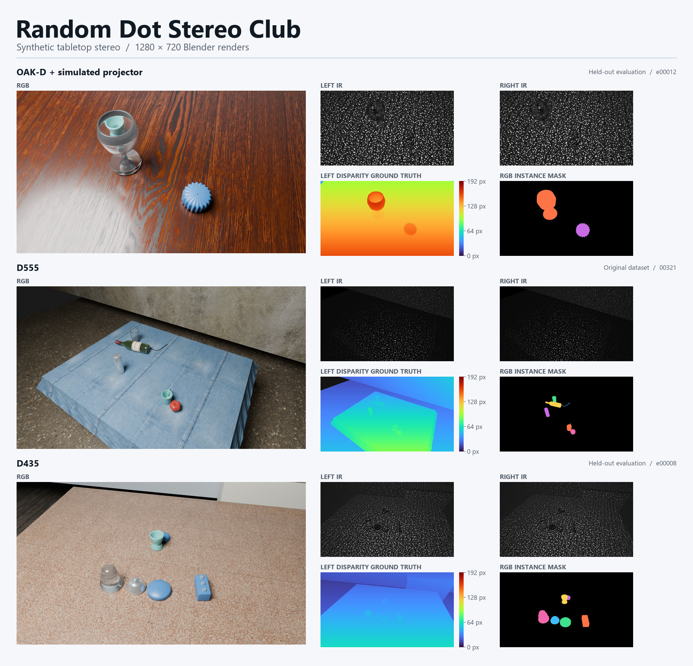
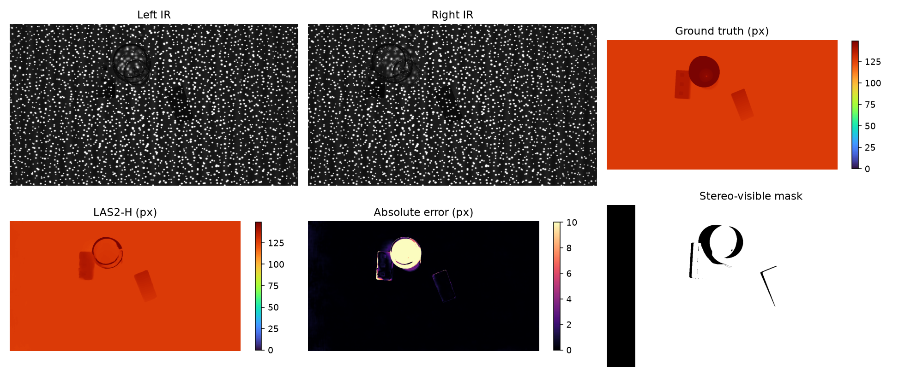

# Random Dot Stereo Club

*For the love of random dots and stereo vision.*

> **Work in progress.** The full **Train** and **Eval** downloads are coming to Zenodo. The links will appear here once the uploads are ready. In the meantime, grab a [sample](#play-with-the-samples) and have fun with it!

Point a random-dot projector at a plain tabletop and suddenly your stereo pair has a pattern to match. That’s what I love about a RealSense setup like the D435 or D555. **Two IR cameras, a color camera, and a random-dot projector!** The projector gives the IR pair texture to work with, and the color camera adds another view. If we already have all three views, why not see what learning-based methods can measure with them?

I wanted a realistic synthetic dataset that would give more people a chance to try those ideas. So I made one. Welcome to the club.

## Dataset at a glance

[](samples/dataset-overview.jpg)

These are renders from the dataset. RGB is shown at a larger size to make the materials, reflections, and transparent objects easier to inspect. Click the image to zoom in.


## Play with the samples

Download the same tabletop scene rendered with three camera configurations. Each ZIP includes the RGB image, left and right IR images, ground-truth disparity maps, masks, and scene metadata. Grab the matching calibration JSON from the next section.

| Camera | Sample data | Visual preview |
| --- | --- | --- |
| D435 | [Download ZIP](samples/D435-e00000.zip) | [View preview](samples/D435.png) |
| D555 | [Download ZIP](samples/D555-e00000.zip) | [View preview](samples/D555.png) |
| OAK-D with a simulated projector | [Download ZIP](samples/OAK-D-active-e00000.zip) | [View preview](samples/OAK-D-active.png) |

The previews show the stereo pair, ground-truth disparity, a LAS2-H prediction, absolute error, and the stereo visibility mask.



## Camera calibration

[D435](calibration/D435.json) · [D555](calibration/D555.json) · [OAK-D with simulated projector](calibration/OAK-D-active.json)

The JSON files contain intrinsics for 1280 × 720 images, the stereo baseline, transforms from the left IR camera to the other views, and the projector position and field of view. The optical axes point right (+X), down (+Y), and forward (+Z). Intrinsics are in pixels and translations are in meters. The simulation uses ideal pinhole cameras with zero lens distortion and nominal camera geometry. The OAK-D variant adds a simulated dot projector.

For positive left IR disparity `d`, depth is `Z = fx_left × baseline / d`. Back-project the pixel with `X_left = Z × inv(K_left) × [u, v, 1]ᵀ`. To project it into RGB, apply `X_rgb = R × X_left + t_m`, then project with `K_rgb`.

## Convert disparity to depth with PyTorch

The [example script](examples/disparity_to_depth.py) loads the calibration JSON and runs a placeholder `predict_disparity(left, right)` function. The placeholder returns 32 pixels everywhere, so the output is a fronto-parallel plane.

```bash
python examples/disparity_to_depth.py --calibration calibration/D435.json --output depth_m.npy
```

To use your own network, replace the example input tensors with a preprocessed, rectified stereo pair and implement `predict_disparity` with your model. Return left-reference disparity in pixels as a `[B, H, W]` tensor on the input device. Remove model padding and, if you resized the images, restore both the calibrated image dimensions and the disparity scale.

The example uses CUDA automatically when available. Use `--device cuda` or `--device cpu` to choose explicitly. The conversion runs on the input device and produces a float32 depth image in meters. Zero, negative, and non-finite disparities become NaN. Positive disparities below 1 px are converted as well.

## Dataset

Scenes are rendered in Blender at 1280 × 720. Each camera configuration includes paired IR views, RGB, ground-truth disparity on the left IR and RGB pixel grids, RGB-aligned instance masks, and masks for geometric validity, stereo visibility, and transparent materials.

Both disparity maps store left-minus-right IR disparity in pixels. In `disparity_rgb.pfm`, those values are sampled on the RGB pixel grid. Ground truth comes from the first surface hit, including transparent surfaces and surfaces occluded in the other IR view. Pixels with no surface hit contain NaN. Camera views share the scene geometry, and the two IR views share a random-dot pattern generated from the scene’s recorded seed.

The **Eval** set uses held-out object shapes, indoor HDRIs, and textures. Paired scene IDs let you compare the same layout across all three camera configurations.

| Download | Status |
| --- | --- |
| Train | Zenodo link coming soon |
| Eval | Zenodo link coming soon |

## For 3D object recognition

The 3D annotations pair each object instance with a local STL mesh and its 6DoF pose at capture time. Instance IDs match the RGB segmentation masks. Mesh coordinates and pose translations are in meters. The JSON gives both `T_left_ir_from_mesh` and `T_rgb_from_mesh` as row-major 4 × 4 matrices acting on homogeneous column vectors. Use the corresponding camera intrinsics to project the mesh into an image. `obb_left_ir` and `obb_rgb` give the oriented box center, full XYZ side lengths, and box-to-camera rotation in each view. The box axes follow the mesh frame. Meshes are shared across camera views of the same scene.


[View the same scene with the oriented 3D bounding boxes projected onto RGB.](samples/obb-pose-overlay.jpg)

This example uses the outlines reconstructed from STL geometry and pose JSON. After projection into the RGB view with the scene's occluders, the instance labels agreed with the dataset mask at all 921,600 pixels.

[Download the STL and pose example](samples/e00000-stl-poses.zip). The example ZIP includes poses and oriented boxes in both the left IR and RGB frames. The full set of 3,072 per-camera pose and oriented-box JSON files will be distributed on Zenodo alongside the Train and Eval image data. The [GitHub mesh bundle](https://github.com/kenovsky/random-dot-stereo-club/archive/refs/heads/3d-data-v1.zip) includes the STL meshes and their matching annotations together. Extract the download, run `python assemble.py` with Python 3.11 or newer, then unzip the verified archive. Pair 3D annotations with the image datasets by camera and scene ID.


### Pair the Train images with the 3D annotations

The GitHub bundle includes all **38 object classes** as **6,425 instance meshes**. Each STL preserves the shape and size used in its scene. The three camera views share the same STL for a given instance.

Each Zenodo Train or Eval archive includes `objects_3d.json` directly in every scene folder, alongside the images, disparity maps, and masks. Extract the archive you need, then extract the GitHub STL bundle into the same data directory to resolve the mesh references. Train archives are organized by camera; the held-out Eval archive contains all three cameras.

```text
random-dot-stereo-data/
├── annotations_3d_v1/
│   └── meshes/
├── dataset_tabletop/                       # D435
│   ├── calibration.json
│   └── samples/00000/
│       ├── rgb.png
│       ├── segmentation_rgb.png
│       └── objects_3d.json
└── dataset_by_camera/
    ├── D555/dataset1000/samples/00000/objects_3d.json
    └── OAK-D-active/dataset1000/samples/00000/objects_3d.json
```

Each scene folder also contains the left and right IR images and disparity maps. To select Train samples, use records with `"split": "train"`. The held-out Eval uses the same per-scene layout under `evaluation_holdout_v1/<camera>/samples/<scene_id>/`.

For example, run this from the common data directory. Paths in the JSON are relative to the scene folder. The instance ID identifies the pixel value in the PNG mask.

```python
import json
from pathlib import Path

scene = Path("dataset_tabletop/samples/00000")
annotation = json.loads((scene / "objects_3d.json").read_text(encoding="utf-8"))
assert annotation["split"] == "train"

rgb_path = scene / annotation["rgb_image"]
mask_path = scene / annotation["rgb_instance_mask"]
instance = annotation["instances"][0]
stl_path = (scene / instance["mesh_stl"]).resolve()
instance_id = instance["instance_id"]
pose_in_rgb = instance["T_rgb_from_mesh"]
obb_in_rgb = instance["obb_rgb"]
```

The GitHub bundle also includes the earlier centralized JSON layout in `annotations_3d_v1/original/` and `annotations_3d_v1/heldout/`. When using those JSONs, resolve paths from the directory containing the JSON file.


## 🍺

If this dataset was useful to you and we ever meet, feel free to buy me a beer.
